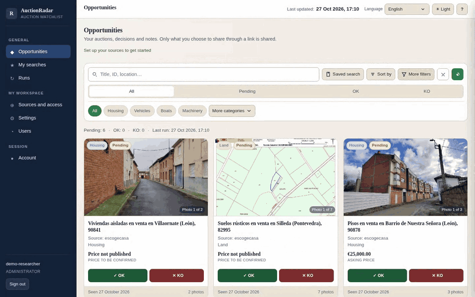

<div align="center">


# AuctionRadar

**Public auctions. Private research. A clearer view.**

A self-hosted workspace to discover listings, inspect the evidence,<br>
and keep your notes and decisions in one place.


[](LICENSE)

[Demo](#see-it-in-action) · [Quick start](#quick-start) · [Self-hosting](docs/SELF_HOSTING.md) · [Documentation](#documentation)

</div>

---

## See it in action



<p align="center">
  <a href="docs/media/auctionradar-demo.mp4">Watch or download the full-resolution video</a> ·
  <a href="docs/media/auctionradar-overview.png">Static screenshot</a> ·
  <a href="docs/DEMO.md">Recording notes</a>
</p>

**A real application, not a mockup.** Recorded locally using public BOE and
Escogecasa results retrieved on October 27, 2026, with a disposable account.
The walkthrough shows filtering, photos, a saved review, and light/dark themes.
It does not demonstrate search execution or authenticated BOE access. Listings
remain in their original language; displayed prices are not verified total costs.

## Built for a careful review

| | What you can do |
| :--- | :--- |
| **Discover** | Configure public HTTPS sources and run bounded searches with per-source coverage and limitations. |
| **Focus** | Filter by asset category, source, location, published amount, photos, and review status. |
| **Inspect** | Browse listing photographs, published facts, document-reading status, and links to original portals. |
| **Decide** | Mark findings as pending, OK, or KO; save private notes and revisit review history. |
| **Keep control** | Separate each account's sources, searches, notes, decisions, and history into private workspaces. |
| **Share selectively** | Create revocable, read-only links without exposing private notes or authenticated material. |

Light and dark themes, a mobile-friendly layout, and English/Spanish UI text
are included. Portal content is never automatically translated.

### A simple workflow

```text
Configure sources → Run a search → Filter findings → Review the evidence
                                                         ↓
                                            Save notes and decisions
                                                         ↓
                                            Share a read-only listing
```

Fresh installations start with **an empty source catalog and no default
accounts**. No personal databases, certificates, saved searches, or installation
history are distributed.

## Quick start

For a local, loopback-only preview. Requires **Python 3.10+** and **curl 8.4+**.
Poppler's `pdftotext` is optional for public PDF text extraction; OpenSSL is
needed for TLS tests.

### 1. Install

```sh
git clone https://github.com/jojoyaco/auctionradar.git
cd auctionradar
python3 -m venv .venv
.venv/bin/pip install --require-hashes -r requirements.txt
.venv/bin/pip install --no-deps -e .
```

### 2. Create your workspace

```sh
export AUCTIONRADAR_WORKSPACE_MODE=private
export AUCTIONRADAR_DATA_DIR="$PWD/instance"
export AUCTIONRADAR_ENV=development
export AUCTIONRADAR_SESSION_SECURE=false

# Enter a password of at least 12 characters at the hidden prompt.
.venv/bin/python -m auctionradar.web.manage create-user --username admin --admin
```

### 3. Start the application

```sh
.venv/bin/gunicorn --bind 127.0.0.1:8000 'auctionradar.web:create_app()'
```

Open **<http://127.0.0.1:8000>**, sign in, and add a public source under
**Sources and access**. Enable the source before a future run. Saving a source
does not contact the portal or start a search.

> **Local preview only.** Do not expose this HTTP development configuration to
> a network. For persistent sessions or multiple workers, configure
> `AUCTIONRADAR_SECRET_FILE` with a private file outside the checkout.
> Production requires HTTPS and protected secrets; follow the
> [self-hosting guide](docs/SELF_HOSTING.md).

Prefer the terminal? Explore the public search CLI with:

```sh
.venv/bin/python -m auctionradar.cli --help
```

## Self-host it on your own infrastructure

Packaging and installation tools target a **fresh, unprivileged Debian 13 LXC**,
with application code separate from persistent data. The installer does not
configure public Internet access or enable scheduled jobs, and a full real-host
Proxmox installation remains unverified.

- [Self-hosting, HTTPS, secrets, and backups](docs/SELF_HOSTING.md)
- [Proxmox installation and packaging](docs/PROXMOX.md)

An optional personal **BOE P12/PFX certificate** can retrieve authenticated asset
photographs. It does not retrieve every BOE document or authenticate to other
portals. Uploading transfers a signing identity to your server: read the
[certificate security notes](docs/SELF_HOSTING.md#optional-boe-certificate) first.

## Know the limits

- **Research, not execution.** No automatic bids, payments, deposits, or seller contacts.
- **Bounded coverage.** Supported connectors are not exhaustive crawlers. Logins,
  arbitrary JavaScript sites, and changing portal markup can limit extraction.
- **Evidence, not assumptions.** Missing photos or unpublished facts stay missing.
  An auction value, asking price, and deposit are different figures—not a total cost.
- **No guarantees.** Listings can be incomplete or outdated. AuctionRadar does not
  verify possession, legal status, fees, or suitability and is not legal or
  investment advice.

## Under the hood

One Python package: a Flask web application, a public search CLI, portal-specific
connectors, and SQLite-backed workspace state. The browser UI uses vanilla
JavaScript and CSS.

```text
auctionradar/
├── cli.py              Public search entry point
├── connectors/         Portal discovery and extraction
├── network.py          Public-destination checks and HTTPS transport
├── documents.py        Public document handling
├── web/                Accounts, workspaces, review, sharing, and UI
└── defaults/           Empty configuration templates
deploy/product/         Release packaging and LXC installation
docs/                   Operator and development guides
tests/                  Automated tests and fixtures
```

### Development checks

```sh
PYTHONDONTWRITEBYTECODE=1 .venv/bin/python -W error::ResourceWarning -m unittest discover -s tests -v
.venv/bin/pip check
node tests/ui_preferences.test.cjs
node tests/review_detail_handler.test.cjs
node tests/detail_next_handler.test.cjs
```

See [verification and test limits](docs/VERIFICATION.md) for browser checks,
packaging checks, linting, and what passing tests do **not** establish.

## Documentation

| Guide | Start here when you want to… |
| :--- | :--- |
| [Self-hosting and security](docs/SELF_HOSTING.md) | Configure HTTPS, accounts, certificates, backups, and isolation. |
| [Proxmox](docs/PROXMOX.md) | Package the application and prepare a new LXC. |
| [Architecture](docs/ARCHITECTURE.md) | Understand package boundaries and the search/review flow. |
| [Verification](docs/VERIFICATION.md) | Run checks and understand their coverage. |
| [Demo assets](docs/DEMO.md) | Reuse the video, GIF, and screenshots or regenerate the GIF. |
| [Licensing](docs/LICENSING.md) | Understand permitted use and restrictions. |
| [Third-party notices](THIRD_PARTY_NOTICES.md) | Review dependency and data terms. |

## License

Original AuctionRadar material is offered under the
[AuctionRadar Noncommercial License 1.0](LICENSE). **Commercial and other
profit-oriented use is prohibited**, including identifying auctions, investments,
purchases, or resales intended to earn a return.

This is a custom, **source-available license**, not an OSI-approved open-source
license. Legal review is pending. See the [licensing guide](docs/LICENSING.md)
for scope and limitations. Third-party components, listing content, and images
retain their own terms; see [THIRD_PARTY_NOTICES.md](THIRD_PARTY_NOTICES.md).
